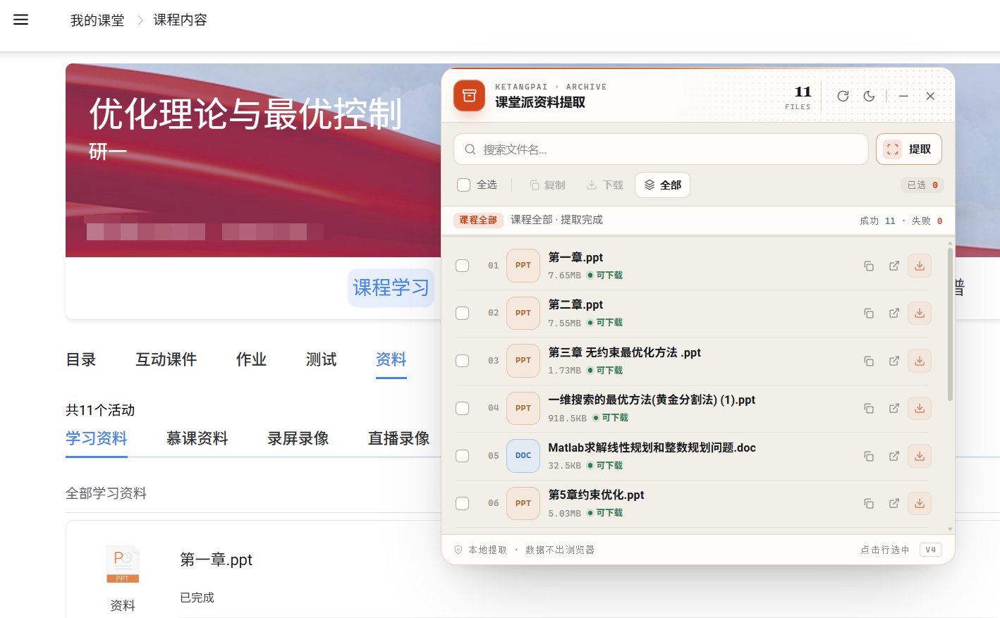
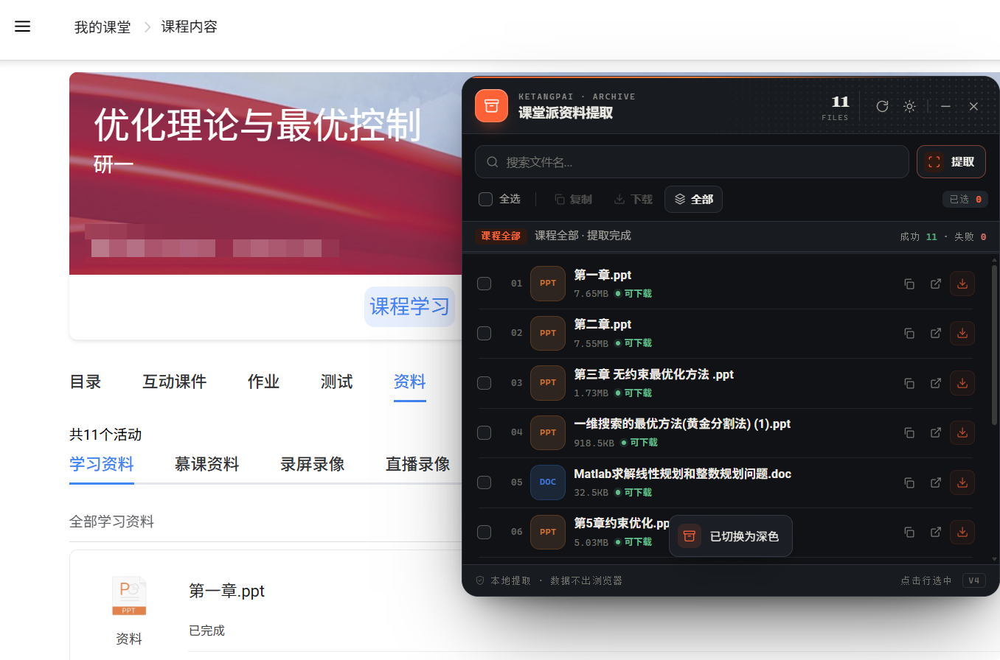
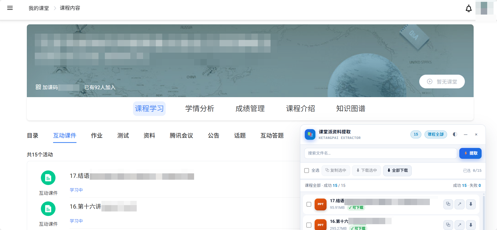
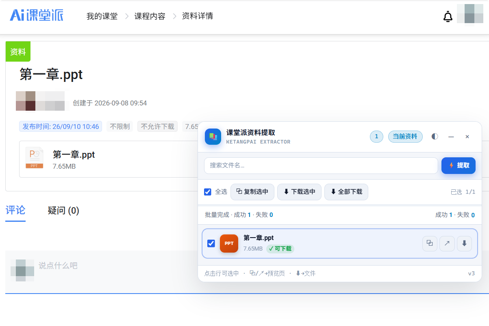
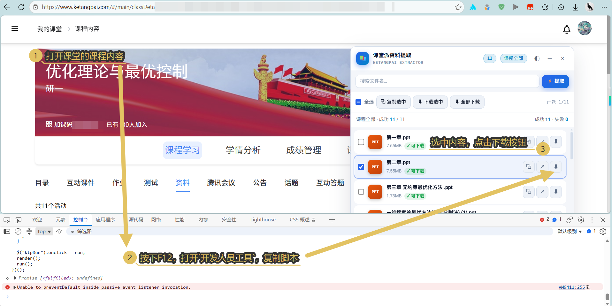

# ketangpai-FileDownload

[toc]

# 前言

起因：

- 缺陷
  1. 部分课件 / 资料被标记为「不允许下载」，只能在线预览
  2. 每次打开都依赖网络，课堂派自带查看器体验一般

- 三年之期：
  1. 三年前，当时正在学习python，顺手制作了一个pdf爬虫脚本【[Ignorant12321/PDFDownload: 课堂派资料区PDF文件多线程下载（突破禁止下载限制）](https://github.com/Ignorant12321/PDFDownload)】，但是如今失效了。
  2. 如今时AI盛行的时代【最近小米出了MIMO 2.6 Flash】，于是开始在openchamber【一个opencode的第三方客户端】 ==vibe coding== 一个新的控制台脚本。

警告：

- **仅供个人学习使用，严禁用于非法用途**

| 浅色（默认） | 深色 |
| --- | --- |
|  |  |

| 互动课件或资料区 |
| --- |
|  |
| 资料详情（仅当前文件） |
|  |

# 使用说明

## 通用面板（推荐）

> - 复制、新窗口打开 → 预览页（`.html`）  
> - 下载 → OSS 原始文件本体【选这个！！！】

步骤：

1. 登录课堂派，打开上述任一页面
2. 按 `F12` 打开开发者工具 → 控制台
3. 打开 [`scripts/ketangpai-panel.js`](scripts/ketangpai-panel.js)，全选复制，粘贴到控制台回车
4. 面板会自动提取；完成后可搜索、多选、复制预览链接、顺序下载
5. 资料区里的文件夹会显示为文件夹行：双击行（或点文件夹图标）进入；点行尾下载图标会递归下载文件夹内所有文件

## 预览页单独下载

1. 打开任意附件的 PluginApp 预览页
2. 控制台粘贴运行 [`scripts/ketangpai-download.js`](scripts/ketangpai-download.js)

## 仅提取链接（无 UI）

在资料详情页运行 [`scripts/ketangpai-links.js`](scripts/ketangpai-links.js)，结果写入 `window.__ketangpaiLinks`。

# 脚本说明

| 文件 | 用途 |
| --- | --- |
| `scripts/ketangpai-panel.js` | **主脚本**：浮动面板，课程页 / 资料页通用 |
| `scripts/ketangpai-download.js` | 预览页内直接下载当前文件 |
| `scripts/ketangpai-links.js` | 资料页提取链接到控制台变量 |

# 注意

- 直链带 `Expires` / `Signature`，**过期后请重新点「提取」**
- 视频会解析播放页里的 mp4 直链；`.wmv` / `.avi` 等转码视频会按实际 `.mp4` 保存。`m3u8` 流暂不支持自动合并
- 压缩包、txt 等文件会优先走官方下载接口，大文件直接交给浏览器保存
- 文件夹支持进入浏览，也支持递归逐个下载（含子文件夹）；批量下载大量文件时浏览器可能询问“是否允许下载多个文件”
- 需已登录课堂派；脚本只在本地控制台执行，不上传数据
- 仅供学习与个人备份课程资料，请遵守学校与平台服务条款

# License

MIT
